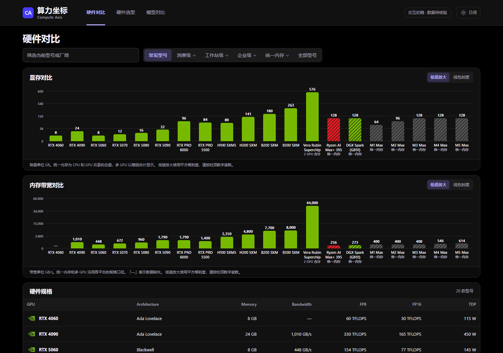

# 算力坐标 Compute Axis

查硬件规格，按准备部署的模型筛选设备。

[硬件对比](#硬件对比) · [硬件选型](#硬件选型) · [部署](#部署)

## 硬件对比

目录收录 329 款硬件。可以按型号、厂商和类别筛选，显存图、内存带宽图与规格表同步更新。图表提供线性刻度和低值放大。

## 硬件选型

可以搜索 5,056 个模型条目，按 Q4、Q6、Q8、FP16 估算显存并筛选候选配置。默认展示 Qwen3.8-27B。生成速度是基于内存带宽的估算，实际部署需核对上下文、推理框架、驱动和多卡互联。

## 部署

运行 `node scripts/build-vercel.cjs`，将 `dist/` 部署到静态托管，或用 `python -m http.server 8000 --bind 127.0.0.1 --directory dist` 本地预览。Vercel 直接读取仓库的部署配置。

## 数据来源

硬件参数参考 Flopper 和厂商资料，硬件选型目录参考 LocalLLM Advisor。品牌图片仅用于识别，原始出处见 [品牌资料](assets/brands/SOURCES.md)。[Flopper](https://flopper.io/gpus) · [LocalLLM Advisor](https://www.localllm-advisor.com/search/hardware)

仓库代码的许可待维护者确定。第三方名称、图标和数据沿用各自的授权条件。
