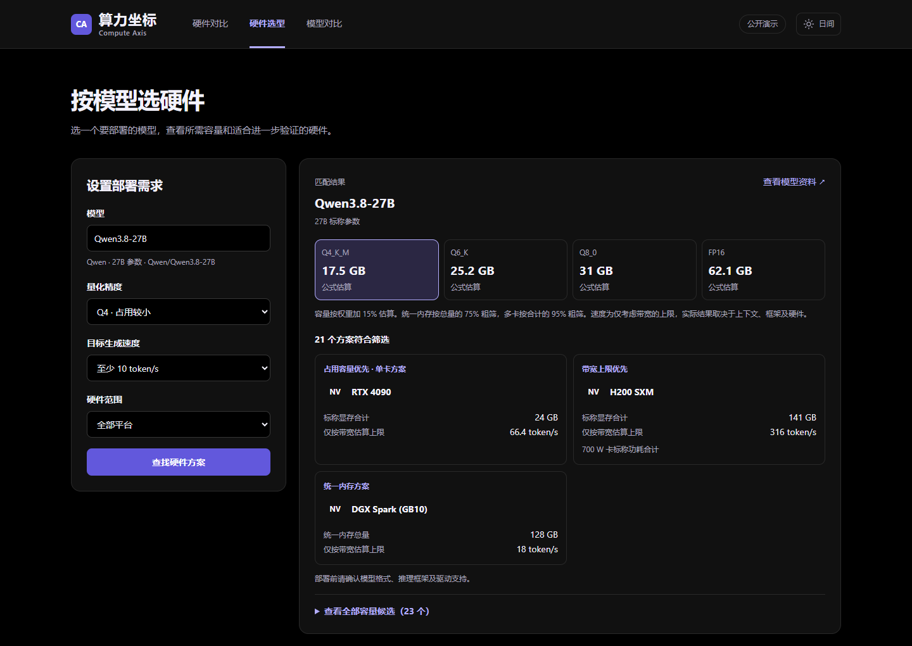
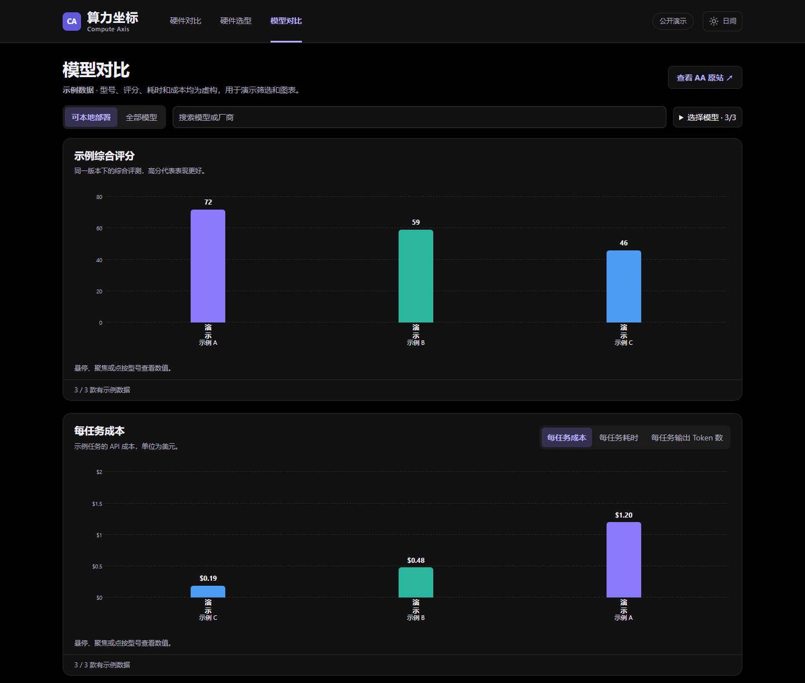

# 算力坐标 Compute Axis

准备在本地运行 AI 模型时，可以先查硬件规格，再按模型和量化精度筛选候选配置。模型对比页也提供交互式图表，便于理解如何比较评分、耗时与成本。

[硬件对比](#硬件对比) · [硬件选型](#硬件选型) · [模型对比](#模型对比) · [本地运行](#本地运行)

## 三大功能

### 硬件对比

按型号、厂商或硬件类别筛选。显存图、内存带宽图和规格表同步更新。图表可在线性刻度和低值放大之间切换，点开型号可查看参数及厂商来源。


### 硬件选型

默认以 **Qwen3.8-27B** 展示推荐。可以搜索其他模型，设置目标生成速度及硬件范围。点击 **Q4、Q6、Q8、FP16** 容量卡，立即重算下方的候选配置。速度按带宽估算上限展示，便于初筛。



### 模型对比

在综合评分、任务开销、评分与成本、分领域排名四张图中比较同一批模型。任务开销可切换成本、耗时和输出 Token 数，搜索和勾选同步作用于四张图。

**图表中的模型与数值均为演示数据。** 真实评测可在 [Artificial Analysis](https://artificialanalysis.ai/zh) 查看。



## 本地运行

可以直接打开 `index.html`，也可以用 Python 3 启动本机 HTTP 预览。

```sh
git clone https://github.com/blackq166s-web/ai-deploy-advisor.git
cd ai-deploy-advisor
python -m http.server 8000 --bind 127.0.0.1
```

打开 [http://127.0.0.1:8000](http://127.0.0.1:8000/)。网站使用原生 HTML、CSS 和 JavaScript，浏览器直接加载随仓库提供的数据。

## 目录结构

| 路径 | 用途 |
| --- | --- |
| `index.html`、`advisor.html`、`models.html` | 三个页面入口 |
| `pages/` | 硬件图表、筛选、选型和模型对比 |
| `app.js`、`theme.js`、`brand-ui.js`、`style.css` | 导航、主题、文字标识和通用样式 |
| `data.js` | 八项硬件示例及逐项厂商链接 |
| `advisor-data.js` | 三项模型元数据，复用同一份硬件规格 |
| `model-demo-data.js` | 虚构评测数据，用于演示图表和筛选 |
| `docs/screenshots/` | 从静态演示版截取的三张页面截图 |

## 数据和估算

- 硬件示例取自厂商规格。统一内存总量与独显显存分别标注，空白字段表示示例目录暂无数据。[NVIDIA](https://www.nvidia.com/en-us/data-center/h200/) · [AMD](https://www.amd.com/en/products/graphics/desktops/radeon/9000-series/amd-radeon-rx-9070xt.html) · [Apple](https://www.apple.com/mac-studio/specs/)
- 模型参数量取自厂商模型卡。[Qwen3.8-27B](https://huggingface.co/Qwen/Qwen3.8-27B) · [Qwen3-8B](https://huggingface.co/Qwen/Qwen3-8B) · [DeepSeek-R1-Distill-Qwen-14B](https://huggingface.co/deepseek-ai/DeepSeek-R1-Distill-Qwen-14B)
- 容量估算按参数量乘以每参数位数再除以 8，另加 15% 余量。统一内存和多卡容量分别按标称总量的 75% 和 95% 粗筛。生成速度用单设备带宽除以权重大小，表示仅考虑带宽时的理论上限。实际部署需核对上下文、推理框架、驱动以及多卡互联。
- 选型交互参考 LocalLLM Advisor。[参考页面](https://www.localllm-advisor.com/search/hardware)
- Artificial Analysis Free API 数据供内部使用，正式数据的分发权限以提供方条款为准。[AA 数据权限说明](https://artificialanalysis.ai/data-api)

## 许可

本仓库的代码许可待维护者确定。第三方名称和资料按各自的权利和条款使用。
